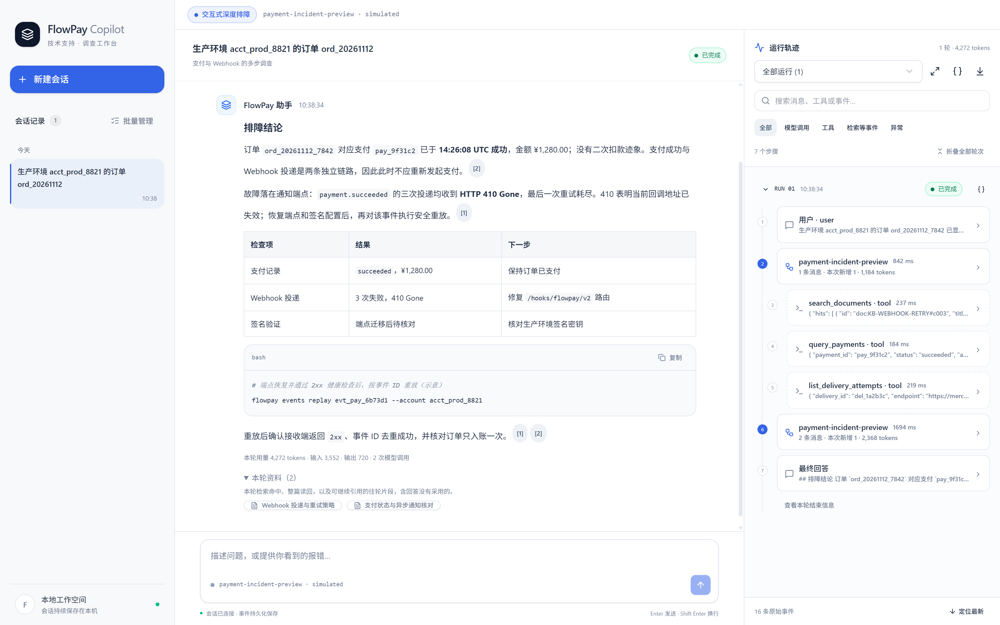
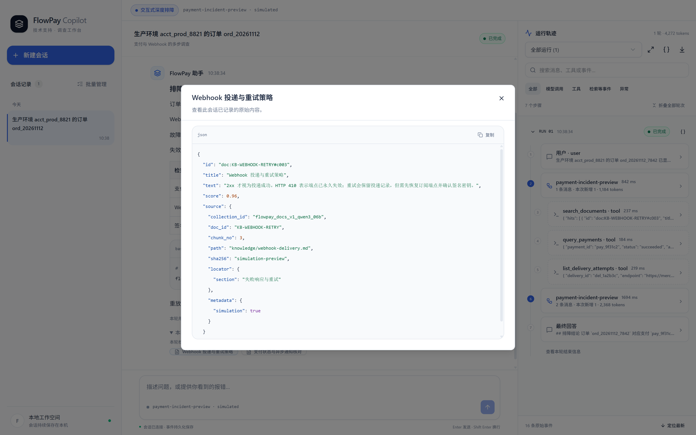
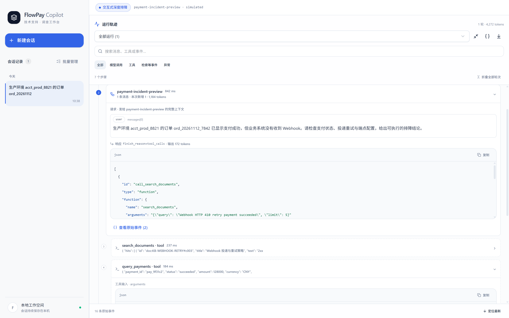
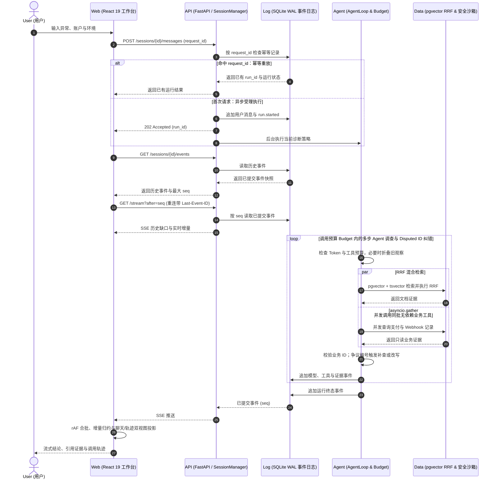

<div align="center">
  <h2>FlowPay Copilot</h2>
  <p>
    <a href="https://github.com/snowcattail/FlowPay-Copilot/stargazers"></a>
    
    
    
    
    
    
    
    <a href="./LICENSE"></a>
  </p>
  <p>面向支付与技术支持场景的 <strong>Agentic RAG 全栈诊断工作台</strong>。</p>
  <p>React + TypeScript 前端将持久化事件投影为对话、证据与运行轨迹；后端通过自研分阶段 Agent Loop 编排模型、文档检索和受控业务查询。</p>
  <p>
    <a href="https://star-history.dera.page/#snowcattail/FlowPay-Copilot&amp;Date"></a>
  </p>
</div>

## 项目预览

项目使用独立分发的仿真支付业务数据与评测包，不连接真实支付生产环境。以下截图展示本地仿真环境中的工作台交互效果。

**三栏响应式排障工作台**



**行内引用角标与证据溯源面板**



**Agent 运行轨迹与调用树检查器**



工程师进入工作台后，可创建仿真排障会话并输入账户、环境或报错信息；既可手动选择诊断策略，也可启用自动路由。React 工作台将事件流投影为对话和运行轨迹，呈现结构化结论、行内证据角标、工具调用树与耗时信息，并支持基于同一会话继续追问。更正账户或环境时，旧条件下的业务编号会失效并触发重查；运行中断后可从持久化状态继续调查。

## 核心功能

支付技术支持场景面临**多数据源割裂、排障链路长、高频流式状态复杂、大模型幻觉敏感**的挑战。FlowPay Copilot 围绕以下四层工程能力构建：

### ⚡ 事件驱动的流式工作台与状态投影

> React 三栏响应式工作台将同一份持久化事件投影为聊天与运行轨迹双视图，支持从结论追溯到调用与证据。

- **纯函数事件投影** — `state.ts` 将事件归约为消息、证据、运行状态与用量；`liveSegments` 按 `call_id` 分隔多步模型输出，隔离工具调用前的过渡文本、被守卫拦截的草稿与正式回答。`trace.ts` 按调用关系还原轨迹树，`trace-index.ts` 在追加事件时只重算受影响的运行。
- **流式订阅与渲染** — 前端先读取历史事件，再以最大 `seq` 订阅 SSE；重放事件按 `seq` 去重。高频正文优先通过 `requestAnimationFrame` 合批，32ms 定时器在 rAF 暂停时提交缓冲；连续事件走追加路径，并通过 useDeferredValue 延后高频流式下的 Markdown 语法树重解析，避免长回复输出阻塞用户滚动与输入交互。
- **引用证据联动** — `react-markdown` 将已知文档与数字引用转为可交互角标，点击即可展开、定位并高亮对应证据卡片，未知引用保留原文。

### 🛡️ 端到端高可靠通信与竞态治理

> 把耗时的多步 Agent 调查从请求主链路中剥离，提交即返回，弱网断线可续传、并发切页不串台。

- **异步受理** — 消息与继续请求返回 `202 Accepted`，后台调查将事件按会话内单调递增的 `seq` 事务化写入 SQLite WAL。
- **游标续传** — API 根据 `after` 与自动重连时的 `Last-Event-ID` 读取已提交事件并补齐缺口，客户端按 `seq` 去重。
- **竞态隔离** — 重复点击由同步忙碌标记拦截，重试复用 `request_id`，刷新版本与订阅生命周期共同防止旧响应串入新页面。
- **取消恢复** — 取消时等待后台任务写入终态；重启后标记未完结运行，失败、取消或中断的调查可从保存状态继续。

### 🔁 受控的多步 Agent 排障状态机

> 自研分阶段 Agent Loop 通过工具证据、业务编号校验和执行预算约束仿真排障过程。

- **多档策略编排** — `s1` 快速文档问答、`s2` 多步文档调查、`s3` 支付与 Webhook 联合取证、`s4` 交互式跨轮诊断。`s2`–`s4` 在各自 workflow 中手写 Agent Loop；模型通过 Tool Calling 提议调用，工具参数经 JSON Schema 校验，同一批无依赖工具用 `asyncio.gather` 并发执行。
- **跨轮条件与显式追问** — 会话保存账户、环境与业务编号；更正范围时移除旧编号并重查。关键条件缺失时，`ask_user` 结构化声明缺项，完整回填当批工具结果后以 `waiting_user` 保存检查点并挂起；用户补充后恢复上下文、合并 `Case` 条件继续调查。
- **业务编号校验** — 回答中的记录编号与用户输入及工具结果交叉比对，发现争议编号时记录事件并在预算内触发改写。
- **预算收敛与查询去重** — 规范化查询键拦截相同参数的重复工具调用；`s2` 每轮最多 5 次模型调用、3 次工具调用，`s3`、`s4` 每轮最多 10 次模型调用、8 次工具调用。上下文 Token 数使用估算值；接近预算上限时折叠旧工具观察，并保留工具调用与结果配对。

### 🔍 混合检索管道与安全数据沙箱

> 兼顾自然语言语义与错误码精确匹配，并对仿真业务快照实施受控只读查询。

- **融合排序** — Ollama Embedding 为查询生成向量；PostgreSQL 中的 pgvector 语义召回与 `tsvector` 全文检索分别排序，再经 RRF 合并，兼顾自然问法、API 字段与错误码。
- **版本与向量空间一致性** — 导入时核对 SHA-256 清单，检索前验证 Embedding 模型身份、维度与请求参数；运行前核对知识库与业务快照版本，底层数据版本变更时要求新建会话，避免历史证据与新数据混用。
- **数据规模与只读护栏** — 独立数据集包含 **100 篇技术文档（本地索引 809 条知识切片）、17 张业务与仿真支撑表及 4 类 JSONL 运行日志**（`api_requests.jsonl`、`usage_buckets.jsonl`、`webhook_delivery_attempts.jsonl`、`service_incidents.jsonl`）。业务工具仅接收结构化范围与过滤条件，读取端以表列白名单、参数绑定、SQLite Authorizer、查询超时和行数上限约束取证。

## 系统流程



## 技术栈

| 层次 | 技术 | 仓库中的用途 |
| --- | --- | --- |
| Web 前端 | React 19、TypeScript 5.9、Vite 7、Tailwind CSS 4、Radix UI、`react-markdown` | 响应式诊断工作台；事件投影、聊天与运行轨迹双视图、Markdown 引用及证据交互。 |
| API 与实时通信 | Python 3.12–3.13、FastAPI、Pydantic 2、Uvicorn、SSE | 会话和运行 API、请求校验、异步受理、历史事件读取与游标续传。 |
| Agent 编排 | OpenAI 兼容聊天接口、自研分阶段 Agent Loop、Tool Calling | `s1`–`s4` 诊断策略、工具参数校验、调用预算、跨轮追问、并发工具和业务编号校验。 |
| 检索与知识库 | Ollama Embedding、PostgreSQL 17、pgvector、`tsvector`、RRF | 文档向量召回、全文召回及融合排序。 |
| 状态存储与数据安全 | SQLite WAL、SQLAlchemy 2、Alembic、psycopg 3、SQLite Authorizer | 会话事件持久化、知识库迁移与连接、仿真业务快照的受控只读查询。 |
| 部署与工程质量 | Docker Compose、Vitest、Pytest、Ruff、Basedpyright、Prettier、TypeScript 编译器 | 本地服务编排、前后端测试、格式检查、类型检查与构建检查。 |

**架构选型说明** — PostgreSQL 承担知识库向量与全文混合检索；SQLite WAL 保存只追加的会话事件溯源日志；独立数据集中的业务 SQLite 快照供受控只读查询。聊天模型通过 OpenAI 兼容接口接入 DeepSeek、OpenAI 或本地兼容服务；Ollama 为知识检索生成 Embedding，二者职责分离。

## 本地运行

仿真业务数据集与基准评测包（Benchmark Dataset）独立分发，**不包含在仓库中**。聊天模型需要自行提供 OpenAI 兼容服务的 API Key；运行期还需要与数据集向量空间一致的 `qwen3-embedding:0.6b`。仓库提供四档诊断模式：`s1` 快速检索、`s2` 多步文档调查、`s3` 跨源联合取证、`s4` 交互式深度诊断；默认使用 `s1`，通过 `STAGE` 切换，也可设置 `STAGE=auto` 按首轮问题自动路由。

### 环境要求

| 组件 | 要求 | 说明 |
| --- | --- | --- |
| Python | `>=3.12,<3.14` | 本机运行启动脚本；宿主机调试后端也需要。 |
| uv | 宿主机调试时需要 | 安装后端依赖；Docker 全栈无需预装。 |
| Node.js / npm | `>=22.12.0`，宿主机调试时需要 | 前端开发、测试与构建；Docker 全栈无需预装。 |
| Docker Compose | Compose v2 | 启动 PostgreSQL、Ollama、后端与前端。 |
| Make / POSIX shell | 使用 `make` 命令时需要 | Windows 建议在 WSL 中运行；也可直接调用 Python 启动脚本。 |

先确认本机所需命令可用；只运行 Docker 全栈时可跳过 `uv` 与 `node` 检查：

```bash
python3 --version
uv --version
node --version
docker compose version
```

### 1. 准备配置

```bash
cp .env.example .env
# 编辑 .env：填写 FLOWPAY_MODEL_API_KEY 与 FLOWPAY_DATASET_ROOT
make doctor
```

`FLOWPAY_DATASET_ROOT` 可指向已解压目录或 `.zip` / `.tar.gz` 包；启动脚本会校验并在需要时解包，要求其中有 `data/knowledge` 与 `benchmark/design`。首次导入知识库还需要数据集内的 `postgres/flowpay_knowledge.dump`。`make doctor` 为只读环境检查，不安装依赖，也不调用聊天模型。可在 `.env` 中选填 `FLOWPAY_MODEL_BASE_URL` 与 `FLOWPAY_MODEL_NAME`；默认值在 `backend/configs/local.toml`。

### 2. 启动基础服务与知识库

**推荐：自动准备并启动全栈。**

```bash
make up                 # 可用 STAGE=s3 make up 切换诊断模式
# 或直接运行：python3 scripts/start.py
```

`make up` 依次启动 PostgreSQL、执行 Alembic 迁移与角色授权、从数据集 dump 恢复知识集合、启动 Ollama 并核对模型 digest，最后启动后端和前端。已就绪的知识集合与模型会复用；提问时的查询向量仍需 Ollama 实时生成。

宿主机调试时，可改用 `make setup SETUP_ARGS=--download-model`：它安装依赖、准备 PostgreSQL 和知识集合，并把嵌入模型安装到宿主机 Ollama。单独启动数据库可运行 `make db-up`，对已有数据库补迁移可运行 `make db-setup`。

### 3. 启动后端

Docker 全栈由 `make up` 启动后端，可通过 `http://127.0.0.1:8000/` 访问 API，并用 `make logs` 跟踪日志。若采用宿主机调试路径，先完成 `make setup SETUP_ARGS=--download-model`，再运行：

```bash
make run STAGE=s3
```

宿主机后端连接 Compose 发布的 PostgreSQL 端口 `127.0.0.1:55432`，并使用本机 `127.0.0.1:11434` 的 Ollama；容器内嵌入服务不对宿主机发布端口。

### 4. 启动前端与质量门禁

Docker 全栈已自动启动前端，访问 `http://127.0.0.1:5173/`。宿主机调试时另开终端运行 `make frontend`，等价于 `npm --prefix frontend run dev`。安装依赖后，可在仓库根目录执行质量检查：

```bash
make quality                                  # scripts/check_quality.py：Ruff、Basedpyright、Pytest、前端格式/测试/构建
backend/.venv/bin/python scripts/check_quality.py --database  # 加跑 PostgreSQL 与 HTTP/SSE 验收
backend/.venv/bin/python -m pytest backend/tests -q
npm --prefix frontend run test               # Vitest
```

`make quality` 调用 `scripts/check_quality.py`，默认不运行独立数据库验收；`--database` 才执行 `scripts/verify_database.py`。未配置数据集时，相关测试会跳过，此时不能视作完整数据集验收。另可用 `make smoke` 对运行中的后端验证 HTTP/SSE 回放、取消与继续。

仓库内置 `benchmark` 评测套件，读取独立数据包 `benchmark/design/benchmark_blueprints.jsonl` 中 **300 道带标准答案和规划证据编号（`planned_evidence_ids`）的排障设计题**，按结论准确性与核心证据命中率对不同诊断策略做自动化回归评测。数据包另有 `benchmark/resolved/resolved_blueprints.jsonl`，其中的 `resolved_evidence_ids` 是已解析的证据编号，不与设计题的规划编号混用。

### 常见问题

| 现象 | 排查方式 |
| --- | --- |
| Windows 上 `make` 或 `backend/.venv/bin/...` 路径不可用 | `Makefile` 使用 POSIX shell 与 `bin` 路径；在 WSL 中运行 `make`。Windows 原生可用 `py -3.12 scripts/start.py` 启动 Docker 全栈，虚拟环境命令改用 `backend/.venv/Scripts/`。 |
| Windows 更新依赖时遇到文件锁 | 先停止占用虚拟环境或前端构建产物的进程，再重试安装或质量检查。 |
| 数据集路径或布局错误 | 核对 `.env` 中的 `FLOWPAY_DATASET_ROOT`；压缩包应有单一顶层目录，解包后须包含 `data/knowledge`、`benchmark/design`，首次导入还须有 dump。 |
| PostgreSQL 连接失败或端口占用 | 检查 `docker compose ps`；宿主机连接 `127.0.0.1:55432`，容器内连接 `postgres:5432`。确认本机 55432、8000、5173 未被占用。 |
| Embedding 模型身份不匹配 | 检查 Ollama 是否运行，以及模型 digest 是否与 `backend/configs/local.toml` 中的 `embedding.revision` 一致；不要通过修改 revision 绕过向量空间校验。 |

停止本地容器且保留数据卷可运行 `make down`。需要清理知识库和嵌入模型数据卷时，先确认数据已备份，再运行 `docker compose down --volumes`。

## 目录结构

```text
.
├── frontend/                    # 工作台与前端测试
│   └── src/
│       ├── App.tsx             # 响应式布局与聊天/轨迹视图
│       ├── components/
│       │   ├── chat-panel.tsx  # 对话、流式内容与证据卡片
│       │   ├── markdown-content.tsx # Markdown、引用角标与代码展示
│       │   ├── run-trace.tsx   # 运行轨迹检查器
│       │   ├── trace-message.tsx # 模型消息与工具上下文
│       │   ├── event-dialog.tsx # 原始事件详情
│       │   ├── session-navigation.tsx # 会话导航
│       │   └── ui/             # 基础交互组件
│       ├── hooks/
│       │   ├── use-session-events.ts # 历史事件与 SSE 订阅
│       │   ├── use-run-actions.ts # 提交、继续、取消与请求幂等
│       │   ├── use-session-catalog.ts # 会话列表与选择
│       │   └── use-trace.ts    # 轨迹视图投影
│       ├── state.ts            # 事件归约与聊天状态投影
│       ├── trace.ts            # 调用关系与轨迹树投影
│       ├── trace-index.ts      # 按运行增量更新轨迹
│       └── lib/session-api.ts  # 会话 HTTP API
├── backend/
│   ├── src/flowpay/
│   │   ├── workflows/           # 多档诊断策略编排与受控 Agent Loop
│   │   ├── core/                # HTTP、执行管理、事件日志、检索、模型与数据源能力
│   │   ├── bootstrap.py         # 依赖装配
│   │   └── router.py            # 阶段注册与选择
│   ├── configs/                 # 本地模型、嵌入与知识库配置
│   ├── migrations/              # Alembic / 知识库迁移
│   └── tests/                   # 后端与脚本测试
├── scripts/                     # 环境准备、知识库导入、验收、质量检查与 benchmark
├── infra/                       # PostgreSQL 初始化及前后端 Dockerfile
├── docs/images/                 # 工作台截图目录
├── compose.yaml                 # PostgreSQL、Ollama、后端、前端编排
├── Makefile                     # 开发与验收命令
└── .env.example                 # 本地环境变量示例
```

## License

本项目采用 [MIT License](https://github.com/snowcattail/FlowPay-Copilot/blob/main/LICENSE)。
