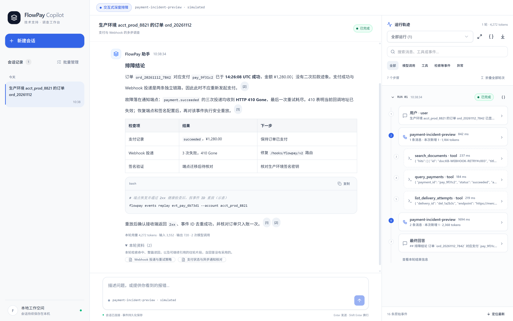
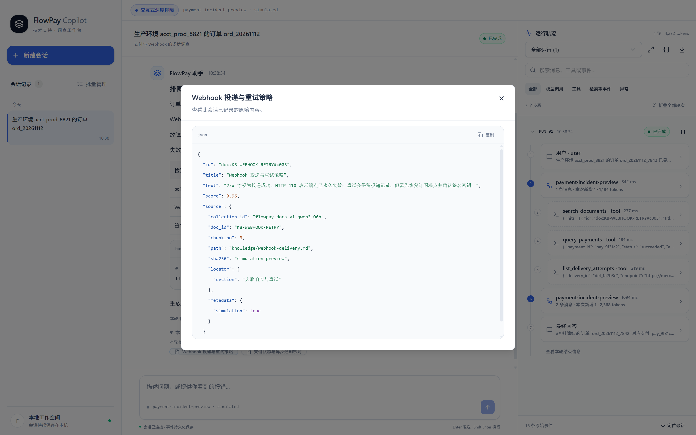
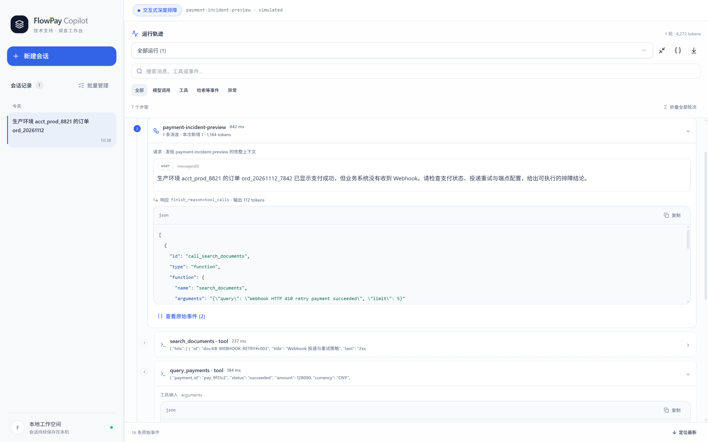
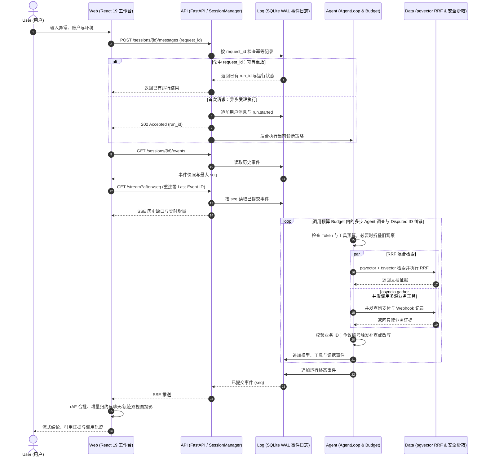

<div align="center">
  <h2>FlowPay Copilot</h2>
  <p>
    <a href="https://github.com/snowcattail/FlowPay-Copilot/stargazers"></a>
    
    
    
    
    
    
    
    <a href="./LICENSE"></a>
  </p>
  <p>面向支付与技术支持场景的 <strong>Agentic RAG 全栈诊断工作台</strong>。</p>
  <p>致力于将分散的技术文档、核心交易表与 Webhook 投递日志转化为可检索、可追溯、可恢复的结构化排障能力。</p>
  <p>
    <a href="https://star-history.dera.page/#snowcattail/FlowPay-Copilot&amp;Date"></a>
  </p>
</div>

## 项目预览

**三栏响应式排障工作台**



**行内引用角标与证据溯源面板**



**Agent 运行轨迹与调用树检查器**



工程师进入工作台后，可创建排障会话并输入线上支付异常的账户、环境或报错信息；既可手动选择诊断策略，也可启用自动路由，由系统将支付异常导向交互式深度诊断。工作台会流式呈现结构化结论、行内证据角标、工具调用树与耗时统计，并支持基于同一会话继续追问。更正账户或环境时，旧条件下的业务编号会失效并触发重查；运行中断后可从持久化检查点继续调查。

## 核心功能

线上支付技术支持天然面临**多数据源割裂、排障链路长、高频流式状态复杂、大模型幻觉敏感**的挑战。FlowPay Copilot 围绕以下四层工程能力构建：

### ⚡ 事件驱动的流式工作台与状态投影

> 将底层离散的持久化事件流解耦映射为聊天与轨迹双视图，高频流式输出不卡顿、长会话不掉帧。

- **纯函数投影** — 将持久化事件归约为消息、证据、运行状态与用量，并按调用关系还原轨迹树，仅更新受影响的运行；`liveSegments` 按 `call_id` 分隔单次运行中的多步模型输出，隔离工具调用前的过渡文本、被守卫拦截的争议草稿与最终提交的正式回答，避免中间态污染聊天正文。
- **流式增量归约** — `requestAnimationFrame` 与 32ms 窗口微批合并高频正文事件，连续游标走追加路径，配合 `useDeferredValue` 延后 Markdown 解析，消除长会话 $O(N^2)$ 重算。
- **引用证据联动** — 已知文档与数字引用转为可交互角标，点击即可展开、定位并高亮对应证据卡片，未知引用保留原文。

### 🛡️ 端到端高可靠通信与竞态治理

> 把耗时的多步 Agent 调查从请求主链路中剥离，提交即返回，弱网断线可续传、并发切页不串台。

- **异步受理** — 消息与继续请求立即返回 `202 Accepted`，后台调查将事件按会话内单调递增的 `seq` 事务化写入 SQLite WAL。
- **游标续传** — 先取历史快照，再以最大 `seq` 建立 SSE 订阅；断线重连补齐已落盘事件，客户端按游标去重。
- **竞态隔离** — 重复点击由同步忙碌标记拦截，重试复用 `request_id`，刷新版本与订阅生命周期共同防止旧响应串入新页面。
- **取消恢复** — 取消时等待后台任务写入终态；重启后标记未完结运行，失败、取消或中断的调查可从保存状态继续。

### 🔁 受控的多步 Agent 排障状态机

> 每条排障结论都必须绑定可在日志与数据库中核验的真实单号证据，拒绝模型自由发挥与捏造。

- **多档策略编排** — 从快速文档问答逐步扩展到多步文档调查、支付与 Webhook 联合取证及交互式跨轮诊断；无依赖工具并发执行。
- **跨轮条件与显式追问** — 会话保存账户、环境与业务编号；更正范围时移除旧编号并重查。关键条件缺失时，`ask_user` 结构化声明缺项，完整回填当批工具结果后以 `waiting_user` 保存检查点并挂起；用户补充后恢复上下文、合并 `Case` 条件继续调查。
- **业务编号校验** — 回答中的记录编号与用户输入及工具结果交叉比对，发现争议编号时记录事件并在预算内触发改写。
- **预算收敛与查询去重** — 规范化查询键拦截相同参数的重复工具调用；单轮最多 10 次模型调用、8 次工具调用，额度临近上限时卸载工具集，引导模型依据已有证据收敛作答。接近 Token 上限时折叠旧工具观察，保留编号与摘要及完整工具调用配对。

```text
[Run #run_01J9 | Seq #142 -> #148 | Mode: Interactive Diagnosis]
Case      account=acct_prod_8821  env=production  payment_id=pay_99201 (Verified)
Tools     [Parallel] query_payments (18ms) + list_delivery_attempts (24ms)
Evidence  doc:webhook-retry#c03 [1] | payment:pay_99201 [2] | attempt:att_7712 [3]
Guard     Disputed ID Check: PASSED (0 hallucinated IDs, token budget: 1,840 / 4,096)
```

### 🔍 混合检索管道与安全数据沙箱

> 兼顾自然语言语义与错误码精确匹配，并在数据库底层构筑只读护栏，保障生产级数据查询安全。

- **融合排序** — pgvector 语义召回与 `tsvector` 词项检索分别排序，再经 RRF 合并，兼顾自然问法、API 字段与错误码。
- **版本与向量空间一致性** — 导入时核对 SHA-256 清单，检索前验证 Embedding 模型身份、维度与请求参数；运行前核对知识库与业务快照版本，底层数据版本变更时要求新建会话，避免历史证据与新数据混用。
- **只读查询护栏** — 底层覆盖 **100 篇技术文档（712 个知识切片）、17 张核心业务关系表与 4 类 JSONL 运行日志（数万行级）**；业务工具仅接收结构化范围与过滤条件，读取端以表列白名单、参数绑定、SQLite Authorizer、时限和行数上限约束取证。

## 系统流程



## 技术栈

| 分层 | 技术 | 仓库中的用途 |
| --- | --- | --- |
| 前端交互层 | React 19、TypeScript 5.9、Vite 7、Tailwind CSS 4、Radix UI、`react-markdown` | 三栏工作台、事件投影、组件与 Markdown 证据引用；Vite 提供开发服务与构建。 |
| 服务端与通信 | Python 3.12+（`<3.14`）、FastAPI、Pydantic 2、Uvicorn、SSE | 会话 API、结构化请求校验、异步运行受理与游标事件订阅。 |
| Agent 与检索 | OpenAI 兼容聊天接口、Ollama Embedding、PostgreSQL 17 + pgvector、`tsvector` | 手写阶段 Agent Loop、Token 预算、文档向量与全文混合检索。 |
| 存储与安全沙箱 | SQLite WAL、SQLAlchemy 2、Alembic、psycopg 3、SQLite Authorizer | 本地事件日志、知识库迁移与连接、业务快照只读查询。 |
| 工程质量与门禁 | Vitest、Pytest、Ruff、Basedpyright、Prettier、TypeScript 编译器 | 前后端测试、Python 规范及类型检查、前端格式和构建检查。 |

**架构选型说明** — 双存储解耦：PostgreSQL 承担多维向量与全文混合检索，SQLite WAL 专职高频只追加的会话事件溯源日志，使运行状态与评测环境按目录轻量隔离。聊天模型通过 OpenAI 兼容协议解耦，切换 DeepSeek、OpenAI 或本地兼容模型无需改代码。

## 本地运行

仿真业务数据集与基准评测包（Benchmark Dataset）独立分发，**不包含在仓库中**。聊天模型需要自行提供 OpenAI 兼容服务的 API Key；运行期还需要与数据集向量空间一致的 `qwen3-embedding:0.6b`。仓库提供四档诊断模式：`s1` 快速检索、`s2` 多步文档调查、`s3` 跨源联合取证、`s4` 交互式深度诊断；默认使用 `s1`，通过 `STAGE` 切换，也可设置 `STAGE=auto` 按首轮问题自动路由。

### 环境要求

| 组件 | 要求 | 说明 |
| --- | --- | --- |
| Python | `>=3.12,<3.14` | 本机运行启动脚本；宿主机调试后端也需要。 |
| uv | 宿主机调试时需要 | 安装后端依赖；Docker 全栈无需预装。 |
| Node.js / npm | `>=22.12.0`，宿主机调试时需要 | 前端开发、测试与构建；Docker 全栈无需预装。 |
| Docker Compose | Compose v2 | 启动 PostgreSQL、Ollama、后端与前端。 |
| Make / POSIX shell | 使用 `make` 命令时需要 | Windows 建议在 WSL 中运行；也可直接调用 Python 启动脚本。 |

先确认本机所需命令可用；只运行 Docker 全栈时可跳过 `uv` 与 `node` 检查：

```bash
python3 --version
uv --version
node --version
docker compose version
```

### 1. 准备配置

```bash
cp .env.example .env
# 编辑 .env：填写 FLOWPAY_MODEL_API_KEY 与 FLOWPAY_DATASET_ROOT
make doctor
```

`FLOWPAY_DATASET_ROOT` 可指向已解压目录或 `.zip` / `.tar.gz` 包；启动脚本会校验并在需要时解包，要求其中有 `data/knowledge` 与 `benchmark/design`。首次导入知识库还需要数据集内的 `postgres/flowpay_knowledge.dump`。`make doctor` 为只读环境检查，不安装依赖，也不调用聊天模型。可在 `.env` 中选填 `FLOWPAY_MODEL_BASE_URL` 与 `FLOWPAY_MODEL_NAME`；默认值在 `backend/configs/local.toml`。

### 2. 启动基础服务与知识库

**推荐：自动准备并启动全栈。**

```bash
make up                 # 可用 STAGE=s3 make up 切换诊断模式
# 或直接运行：python3 scripts/start.py
```

`make up` 依次启动 PostgreSQL、执行 Alembic 迁移与角色授权、从数据集 dump 恢复知识集合、启动 Ollama 并核对模型 digest，最后启动后端和前端。已就绪的知识集合与模型会复用。知识集合的 100 篇文档、712 个向量由数据集恢复，提问时的查询向量仍需 Ollama 实时生成。

宿主机调试时，可改用 `make setup SETUP_ARGS=--download-model`：它安装依赖、准备 PostgreSQL 和知识集合，并把嵌入模型安装到宿主机 Ollama。单独启动数据库可运行 `make db-up`，对已有数据库补迁移可运行 `make db-setup`。

### 3. 启动后端

Docker 全栈由 `make up` 启动后端，可通过 `http://127.0.0.1:8000/` 访问 API，并用 `make logs` 跟踪日志。若采用宿主机调试路径，先完成 `make setup SETUP_ARGS=--download-model`，再运行：

```bash
make run STAGE=s3
```

宿主机后端连接 Compose 发布的 PostgreSQL 端口 `127.0.0.1:55432`，并使用本机 `127.0.0.1:11434` 的 Ollama；容器内嵌入服务不对宿主机发布端口。

### 4. 启动前端与质量门禁

Docker 全栈已自动启动前端，访问 `http://127.0.0.1:5173/`。宿主机调试时另开终端运行 `make frontend`，等价于 `npm --prefix frontend run dev`。安装依赖后，可在仓库根目录执行质量检查：

```bash
make quality                                  # scripts/check_quality.py：Ruff、Basedpyright、Pytest、前端格式/测试/构建
backend/.venv/bin/python scripts/check_quality.py --database  # 加跑 PostgreSQL 与 HTTP/SSE 验收
backend/.venv/bin/python -m pytest backend/tests -q
npm --prefix frontend run test               # Vitest
```

`make quality` 调用 `scripts/check_quality.py`，默认不运行独立数据库验收；`--database` 才执行 `scripts/verify_database.py`。未配置数据集时，相关测试会跳过，此时不能视作完整数据集验收。另可用 `make smoke` 对运行中的后端验证 HTTP/SSE 回放、取消与继续。

仓库内置 `benchmark` 评测套件，可用独立数据包中 **300 道带标准答案与黄金证据编号的排障题**，按结论准确性与核心证据命中率对不同诊断策略做自动化回归评测。

### 常见问题

| 现象 | 排查方式 |
| --- | --- |
| Windows 上 `make` 或 `backend/.venv/bin/...` 路径不可用 | `Makefile` 使用 POSIX shell 与 `bin` 路径；在 WSL 中运行 `make`。Windows 原生可用 `py -3.12 scripts/start.py` 启动 Docker 全栈，虚拟环境命令改用 `backend/.venv/Scripts/`。 |
| Windows 更新依赖时遇到文件锁 | 先停止占用虚拟环境或前端构建产物的进程，再重试安装或质量检查。 |
| 数据集路径或布局错误 | 核对 `.env` 中的 `FLOWPAY_DATASET_ROOT`；压缩包应有单一顶层目录，解包后须包含 `data/knowledge`、`benchmark/design`，首次导入还须有 dump。 |
| PostgreSQL 连接失败或端口占用 | 检查 `docker compose ps`；宿主机连接 `127.0.0.1:55432`，容器内连接 `postgres:5432`。确认本机 55432、8000、5173 未被占用。 |
| Embedding 模型身份不匹配 | 检查 Ollama 是否运行，以及模型 digest 是否与 `backend/configs/local.toml` 中的 `embedding.revision` 一致；不要通过修改 revision 绕过向量空间校验。 |

停止本地容器且保留数据卷可运行 `make down`。需要清理知识库和嵌入模型数据卷时，先确认数据已备份，再运行 `docker compose down --volumes`。

## 目录结构

```text
.
├── frontend/                    # React 工作台：组件、事件投影、订阅 Hooks 与 Vitest
│   └── src/
├── backend/
│   ├── src/flowpay/
│   │   ├── workflows/           # 多档诊断策略编排与受控 Agent Loop
│   │   ├── core/                # HTTP、执行管理、事件日志、检索、模型与数据源能力
│   │   ├── bootstrap.py         # 依赖装配
│   │   └── router.py            # 阶段注册与选择
│   ├── configs/                 # 本地模型、嵌入与知识库配置
│   ├── migrations/              # Alembic / 知识库迁移
│   └── tests/                   # 后端与脚本测试
├── scripts/                     # 环境准备、知识库导入、验收、质量检查与 benchmark
├── infra/                       # PostgreSQL 初始化及前后端 Dockerfile
├── docs/images/                 # 工作台截图目录
├── compose.yaml                 # PostgreSQL、Ollama、后端、前端编排
├── Makefile                     # 开发与验收命令
└── .env.example                 # 本地环境变量示例
```

## License

本项目采用 [MIT License](https://github.com/snowcattail/FlowPay-Copilot/blob/main/LICENSE)。
